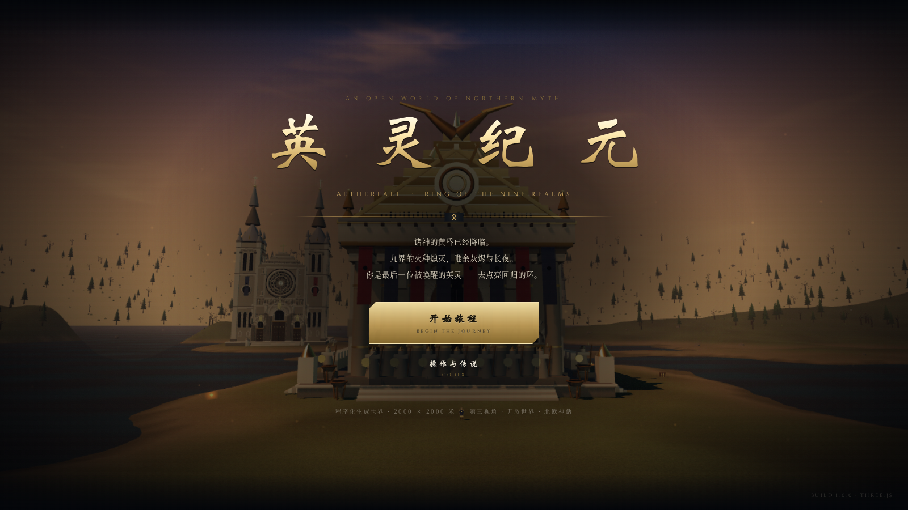
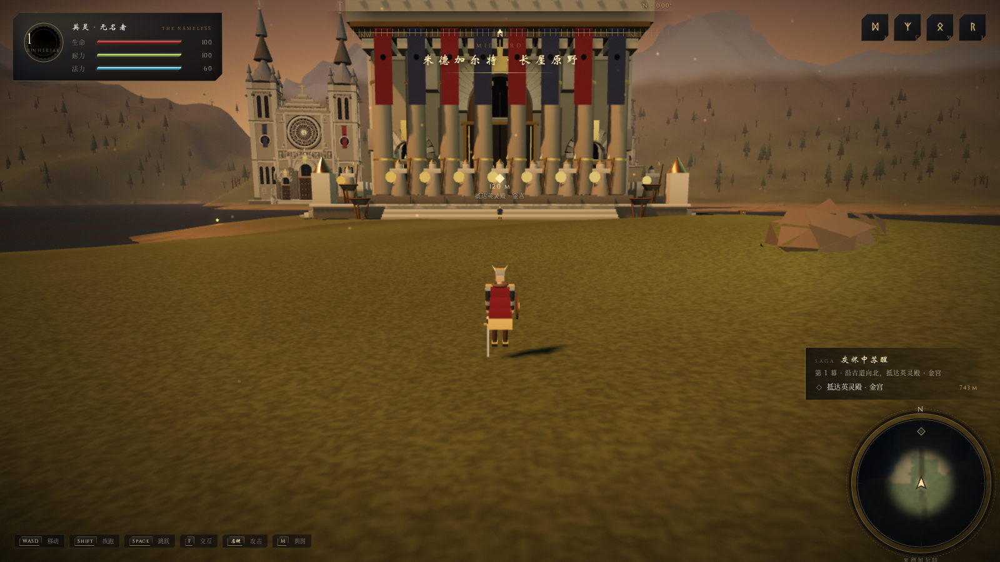
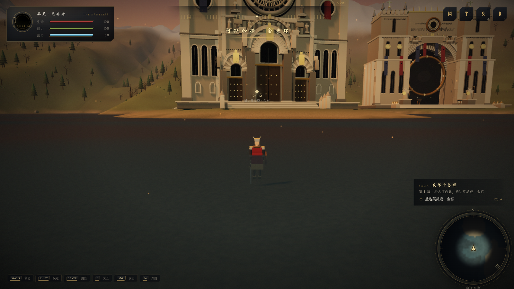
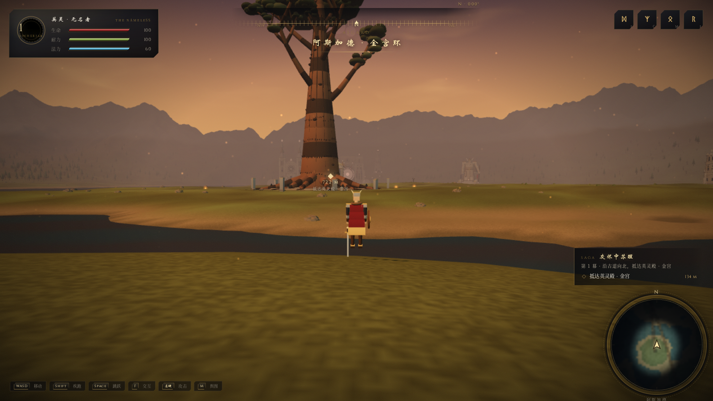
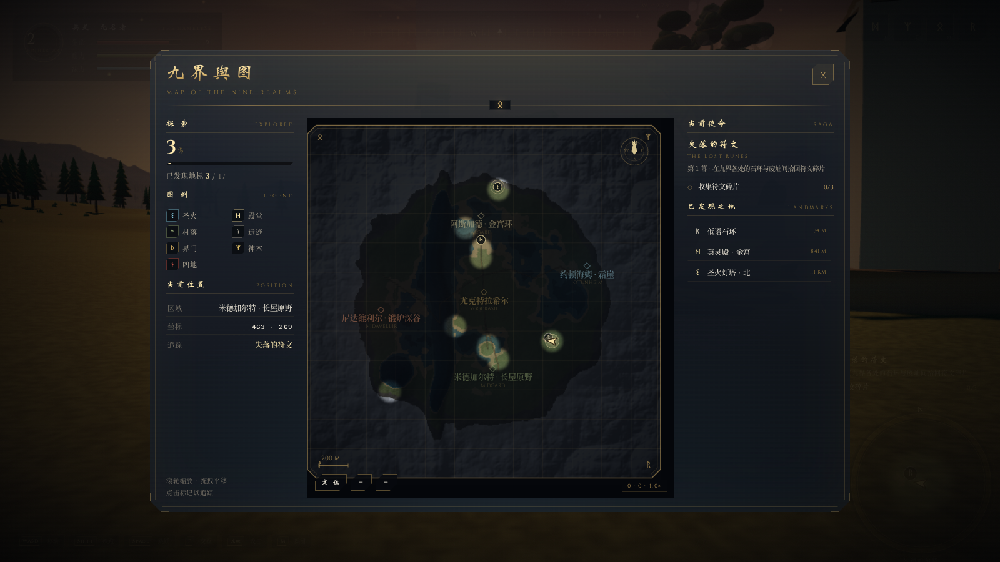
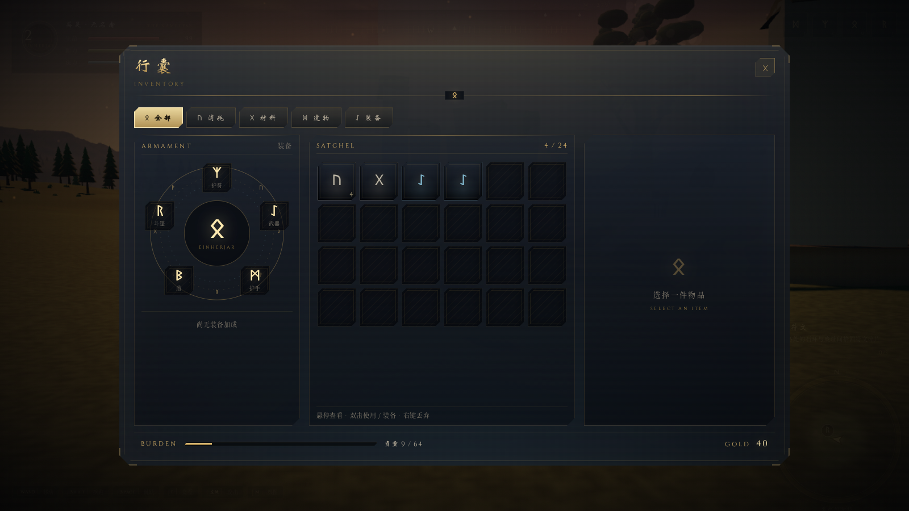
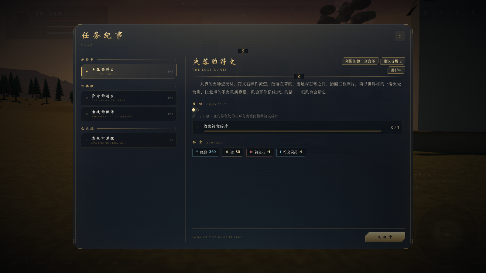
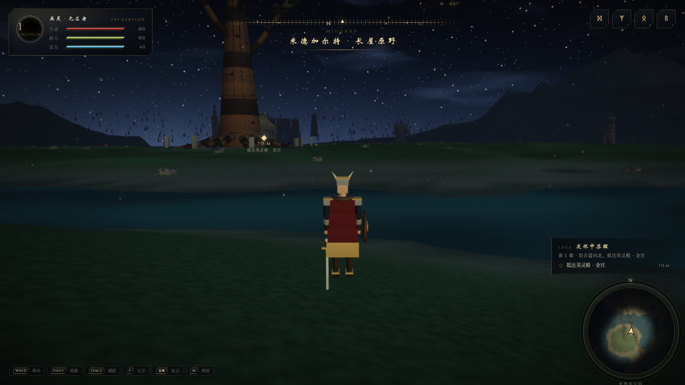

# 英灵纪元 · 九界之环

**AETHERFALL — RING OF THE NINE REALMS**

第三人称开放世界 · 北欧/西欧神话 · 程序化生成 · 浏览器原生 Three.js · 零运行时依赖。

> 诸神的黄昏已经降临。九界的火种熄灭，唯余灰烬与长夜。
> 你是最后一位被唤醒的英灵——去点亮回归的环。

---

## 截图

| | |
|---|---|
|  |  |
|  |  |
|  |  |
|  |  |

---

## 快速开始

```bash
node server.mjs 8080
# 浏览器打开 http://127.0.0.1:8080
```

> ES Modules 必须通过 http(s) 加载，直接双击 `index.html` 无法运行。
> `node server.mjs` 是零依赖静态服务器（Node ≥ 18）。
> 画质：URL 加 `?q=low` / `?q=medium` / `?q=high`（默认 high，自动根据帧率降采样）。

---

## 操作

| 操作 | 按键 |
|---|---|
| 移动 | `W A S D` |
| 疾跑（消耗耐力） | `Shift` |
| 跳跃 | `Space` |
| 视角 | 鼠标（点击画面锁定） |
| 旋转视角（备用） | `Q` / `E` |
| 缩放视角 | 滚轮 |
| 交互 / 对话推进 | `F` |
| 攻击 | 鼠标左键 / `J` |
| 行囊 | `I` |
| 英灵状态 | `C` |
| 九界舆图 | `M` |
| 任务纪事 | `L` |
| 关闭界面 | `ESC` / `Tab` |
| 保存 / 读取 | `F5` / `F9` |
| 性能面板 | `F3` |

---

## 已实现的内容

### 世界
- **2400 × 2400 米的程序化地形**：分块流式加载、高度/坡度/区域着色、河谷与镜湖、山脉环、雪线。
- **14 座可探索地标**，由程序化建筑生成器构建（几何按材质合并，单建筑 4–8 个 draw call）：
  - 世界树 · 尤克特拉希尔（216m）、英灵殿 · 金宫（66m）、圣白大教堂（107m）、守望者巨像（57m）
  - 阿斯加德界门（82m）、四座圣火灯塔（69m）、霜崖瞭望塔、低语石环、长屋村 · 阿斯克、霜河石桥（4 拱）
- **天空**：程序化 Shader 穹顶（日轮、月轮、星野、极光帷幕、高空薄云、地平线暖带、时间调色板）。
- **昼夜循环**（15 分钟一天）、动态雾、程序化环境反射（金属/冰面）、阴影跟随玩家。
- **植被与散石**：4 个 InstancedMesh 绘制 7000+ 实例，按高度/坡度/区域分布（北境积雪、东境霜原）。
- **空气微尘**：GPU 包围盒循环粒子，黄昏金色余烬 / 夜晚冷蓝雪尘。

### 角色与战斗
- 程序化人形角色：髋-躯干-头-双臂-双腿-斗篷-武器-盾，程序化动画（待机/行走/奔跑/跳跃/挥砍）。
- 第三人称弹簧臂相机：鼠标环绕、滚轮缩放、地形与建筑碰撞收缩、镜头抬升、受击抖动。
- 近战战斗：扇形判定、伤害/护甲/耐力、敌人 AI（游荡/追击/前摇/攻击/死亡）、掉落、延迟重生。
- 敌人：尸鬼（近战斧）、霜狼（快速扑咬），头顶血条。

### 系统
- **属性/状态系统**：生命、耐力、法力、等级/经验、护甲/攻击/移动速度、Buff/Debuff（含持续时间与 tick）、死亡与复活。
- **背包系统**：24 格、5 个装备槽（武器/盾/斗篷/护符/护手）、分类页签、稀有度、负重、使用/装备/丢弃、物品详情。
- **地图系统**：8m 网格战争迷雾、90m 渐进揭示、一次性烘焙地形底图（雪/岩/草/水 + 区域色调 + 道路）、POI 发现、小地图、罗盘、大地图缩放/拖拽/悬停/追踪。
- **任务系统**：4 条主线 + 2 条支线、阶段/目标推进、任务链自动接续、奖励、追踪、纪事面板、屏幕目标标记与距离。
- **交互系统**：统一的可交互物扫描（圣火、NPC、宝箱、拾取物），提示、对话条、一次性交互移除。
- **存档**：localStorage 全量存档（玩家/属性/背包/地图/任务/世界状态/时间），F5/F9，90 秒自动保存。
- **音频**：纯 WebAudio 程序化合成的环境 Drone、风、极光铃音、音乐和声与 15 种音效，随战斗/探索切换情绪。

### 界面（史诗风格）
黑曜石 + 古金 + 极光青；切角面板、双金线、符文分隔、Cinzel 显示字体 + 中文衬线；
载入屏符文环、标题界面实时电影镜头、区域标题卡、任务完成横幅、受击红晕、死亡遮罩、性能面板。

---

## 工程架构

```
index.html                 入口（importmap + DOM 骨架）
server.mjs                 零依赖静态服务器
vendor/                    three.module.js / BufferGeometryUtils.js（本地化，离线可用）
assets/fonts/              Cinzel 字体
src/
  main.js                  唯一组装点：启动顺序、主循环、重生、标题流程
  core/                    EventBus / Input / Engine / Rng / GeomUtil
  render/                  Materials / Sky / Atmosphere / Water / Motes
  world/                   Terrain / World / Vegetation / Landmarks
  world/architecture/      Kit（几何构建套件）+ 9 个建筑生成器
  entities/                Player / ThirdPersonCamera / Humanoid / Npc / Enemy
  systems/                 Stats / Inventory / Map / Quest / Combat / Interaction / Save / Audio
  ui/                      UIManager / HUD / 各面板
  ui/styles/               theme.css（设计系统）/ hud.css / inventory.css / mapquest.css
  data/                    world.js（世界布局）/ items.js（物品）/ quests.js（任务）
docs/ARCH.md               完整架构与协作契约（事件表、系统接口、视觉规范、性能红线）
tools/                     开发期检查脚本（导入检查、无头浏览器截图/回归）
```

### 分层原则

1. **组装与实现分离**：`main.js` 只负责顺序与装配，不包含玩法逻辑。
2. **系统横向解耦**：所有系统通过 `EventBus` 通信，不互相 `import` 实现（只依赖文档化的事件契约）。
3. **数据驱动**：地标、物品、任务全部是纯数据（`src/data`），新增内容不需要改引擎。
4. **几何合并**：建筑用 `Kit` 在构建期按材质合并为极少数 Mesh；角色按身体部件合并；植被全部实例化。
5. **容错**：系统通过动态 `import` 装配，任一模块缺失/加载失败时降级为桩，世界仍可运行。
6. **确定性**：所有程序化内容由 `Rng`（种子）驱动，同一 seed 生成同一世界。

### 如何扩展

**新增一件物品**：在 `src/data/items.js` 增加定义（use / equip 字段会被系统自动解释）。

**新增任务**：在 `src/data/quests.js` 增加定义，并把 id 放进 `QUEST_ORDER` / `QUEST_CHAIN`；
目标类型 `collect | kill | reach | interact | light` 已在任务系统中实现。

**新增地标**：
1. 在 `src/world/architecture/` 写一个 `buildXxx(opts) -> THREE.Group`（用 `Kit`），
   返回体通过 `kit.collider/boxCollider` 注册碰撞、`userData.platforms` 注册可行走面；
2. 在 `src/world/Landmarks.js` 的 `BUILDER_TABLE` 注册；
3. 在 `src/data/world.js` 的 `LANDMARKS` 增加一条（坐标、朝向、压平半径、POI）。
   建筑生成器必须把 `opts.scale` 烘焙进几何，`group.scale` 保持 1。

**新增系统**：
实现 `constructor(game) / init() / update(dt)`（可选 `toJSON/fromJSON`），
加入 `src/main.js` 的 `SYSTEM_TABLE` 或直接实例化，并通过事件与其它系统通信。

**改 UI**：所有视觉令牌在 `src/ui/styles/theme.css`；面板通过 `UIManager.registerPanel` 注册，
HUD 插槽通过 `ui.slot('minimap' | 'compass' | 'questtracker')` 挂载。

---

## 性能策略

- draw call：建筑按材质合并（单建筑 4–8 DC）、植被 4 个 InstancedMesh、地形分块剔除。
- 三角形：高画质约 100 万，低画质约 45 万；可在 `?q=low|medium|high` 与 `Engine` 预设中调整。
- 阴影：仅太阳平行光，2048²，紧凑视锥跟随玩家；低画质关闭。
- 自适应分辨率：低于 40 FPS 自动降 pixelRatio，高于 58 FPS 逐步恢复。
- 地形流式加载：只构建玩家周围区块（半径 4），每帧最多 2 块。
- 地图：底图一次性烘焙；小地图/罗盘 12 FPS 重绘；面板只在打开时刷新。
- 事件/轮询：HUD 数值 7Hz 轮询，避免高频 DOM 更新；任务追踪器按签名重建。

`F3` 可查看 FPS / draw call / 三角形 / pixelRatio / 区块数。

---

## 已知边界与后续路线

- 目前为单机单区域（九界以"区域"形式呈现，尚未做跨图传送）。
- 战斗为轻量近战，后续可扩展技能、元素、Boss 阶段。
- 建筑生成器可继续参数化（variant/seed 已预留）；可增加室内空间与可进入建筑。
- 音频为程序化合成，若接入音频资源可直接替换 `AudioSystem.play`。
- 存档为本地 localStorage；可替换为后端 API（`SaveSystem.collect/apply` 已是纯数据）。

---

## 开发期工具

```bash
node tools/check-imports.mjs        # 检查所有相对导入是否存在
node tools/final-tour.cjs           # 无头浏览器全流程回归 + 截图（需要 playwright）
```

（`tools/` 仅开发使用，不参与运行时。）
